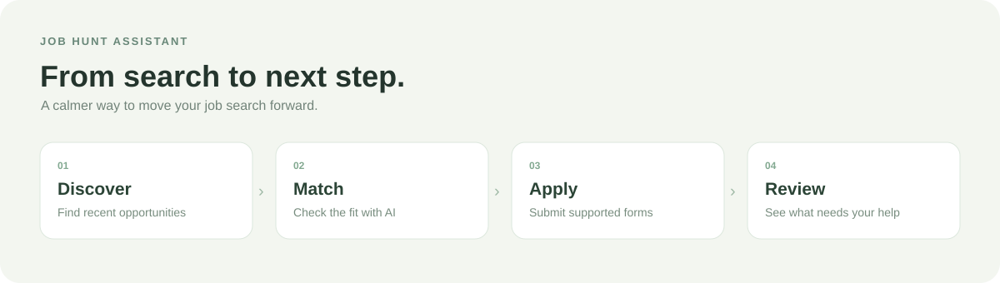

<div align="center">

# Job Hunt Assistant

**Find promising roles. Spend less time on repetitive applications.**

A personal job-search assistant that brings discovery, AI matching, and supported applications into one simple workspace.



</div>

## The idea

Job hunting can mean checking the same sites, reading similar descriptions, and entering the same details again and again. Job Hunt Assistant brings those steps together: it looks for recent opportunities, checks them against your resume, and applies automatically when it can safely complete a supported form.

You choose when a search starts. The app shows what happened, highlights applications that need your attention, and can stop after the current job.

## What you can do

- **Discover recent jobs:** prioritize listings from the last 30 days with a verified posting date. Start with India and worldwide remote roles, or search more widely.
- **Check the fit:** use your own OpenAI, Gemini, or Claude API key and choose a suggested model or another model ID.
- **Apply where supported:** submit up to 10 straightforward applications per search using your contact details and existing resume.
- **Stay informed:** see progress, open jobs that need manual attention, and avoid automatically retrying an uncertain or previously attempted submission.

The app attaches the resume you provide; it does not rewrite it. It searches selected public sources, not every job site. Some forms need extra answers, login, or human verification and are left for you to complete. AI matching and automatic submission are not guaranteed.

Read-only search has been smoke-tested with public listings. AI calls and application submissions have only been tested with simulated responses and forms.

## Get started

No coding is needed to use the app, but you do need Python and an AI provider API key.

1. **Download the project.** On this page, select **Code → Download ZIP**, then unzip the downloaded folder.
2. **Install Python 3.11 or newer** from [python.org](https://www.python.org/downloads/). On Windows, select **Add Python to PATH** during installation.
3. **Open the unzipped folder and start the app:**
   - **Windows:** double-click `Start-Windows.bat`.
   - **Mac:** double-click `Start.command`.
   - **Ubuntu:** allow `Start-Linux.sh` to run as a program, then open it. If your desktop opens the file as text, open a terminal in the folder and run `bash Start-Linux.sh`. If setup says the virtual environment is unavailable, run `sudo apt install python3-venv` once and try again.
4. **Wait for the page to open.** The first start installs the app and its browser, so it can take a few minutes. Keep the terminal window open while using it.
5. **Set up your search.** Enter the job you want, your contact details, and a text-based PDF resume. Choose an AI provider, select **Get an API key**, then copy the key from that provider and paste it into the page. A provider account and API billing may be required.
6. **Start when ready.** Review the confirmation and select **Find and apply**. This can send real applications. Use **Stop after current job** if you want to stop.

Mac startup has been tested locally. The Windows and Ubuntu launchers have automated checks but have not yet been tested on those operating systems.

### If you get stuck

- **The browser did not open:** copy the local address shown in the terminal into your browser.
- **The AI provider rejects your key or model:** check the selected provider, key, model access, and any required API billing; then try again.
- **No matching jobs appeared:** try a broader job title or location.

## Your choices and privacy

- Your API key stays in the current browser tab after a search. It clears when you refresh, close the tab, or change providers; the app does not save it to disk.
- Starting a search sends resume text and job preferences to your chosen AI provider. Supported applications send your resume and contact details to the employer. Provider terms and API charges vary; Gemini's free tier may use submitted data to improve Google's products.
- Your resume is temporarily copied into `.local` during a search and normally removed afterward. Application attempt records remain on your computer in `.local/applications.sqlite3`. If the app is interrupted, check `.local` for a leftover temporary PDF. Keep that folder private.

## Model suggestions

Start with a low-cost model for matching: **GPT-6 Luna**, **Gemini 3.5 Flash-Lite**, or **Claude Haiku 5.5**. The app also offers other models, including GPT-6.1 Terra, or lets you enter a model ID. Check [OpenAI](https://developers.openai.com/api/docs/pricing), [Gemini](https://ai.google.dev/gemini-api/docs/pricing), or [Claude](https://platform.claude.com/docs/en/about-claude/pricing) pricing and compare accuracy on your own jobs before relying on any model.

## For developers

```sh
python3 -m venv .venv
source .venv/bin/activate
pip install -r requirements-dev.txt
export PLAYWRIGHT_BROWSERS_PATH="$PWD/.local/playwright"
python -m playwright install chromium
python -m pytest -q
```

Tests use synthetic candidate details, mocked AI, and simulated forms. Real AI calls and real applications have not been tested in this copy.
